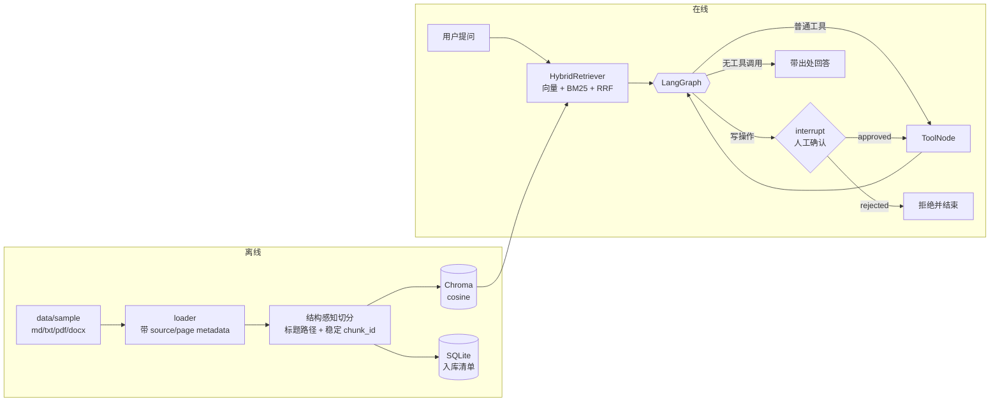

# agent-rag

公司内部知识库智能体：文档入库 → 混合检索（向量 + BM25）→ 带出处回答 → **写操作人工确认**。

一个可以真正拿出来用的工程骨架，不是又一个"跟着教程跑通的 demo"。

---

## 它和"RAG demo"的区别

| 维度 | 常见 demo | 本项目 |
|---|---|---|
| 入库 | 每次启动 `Chroma.from_documents` 重建 | 独立 CLI，按文件 hash 幂等增量，改过的文件自动替换旧 chunk，删掉的文件自动清理 |
| 会话状态 | 进程内 dict，重启即失忆 | SQLite + LangGraph checkpointer，重启可恢复 |
| 人工确认 | 在 `on_tool_start` 里 `return`，工具其实已经执行了 | `interrupt()` 在执行**之前**挂起整个图，确认后才继续 |
| 工具鉴权 | 员工姓名由 LLM 从对话里生成 | 身份来自请求上下文，模型的工具 schema 里根本没有这个参数 |
| 写操作 | 无幂等，可能重复扣减 | 唯一键"占坑 → 记账"，同一请求只成功一次 |
| 检索 | 纯向量 `k=2` | 向量 + BM25 混合，RRF 融合，可开关 |
| 评测 | 无 | 7 条 golden set + recall@k / MRR / 关键词覆盖，可做 CI 卡口 |
| 稳定性 | 无步数上限，可能死循环烧钱 | `MAX_AGENT_STEPS` 兜底 |
| 异步 | `requests` 阻塞事件循环 | 全链路 `httpx` / async |
| 安全 | 密钥硬编码在源码里 | 只读 `.env`，`.env` 不进仓库 |

---

## 架构



---

## 快速开始

```bash
# 1. 配置（.env 不会进仓库）
cp .env.example .env
#    编辑 .env，至少填 DEEPSEEK_API_KEY

# 2. 安装（需要 uv：https://docs.astral.sh/uv/）
uv sync

# 3. 入库（幂等，可以反复跑）
uv run agent-rag ingest data/sample

# 4. 提问
uv run agent-rag ask "入职满三年有几天年假？"
uv run agent-rag ask "帮我请两天病假，去医院复查" --user 张三

# 5. 检索评测
uv run agent-rag eval -k 5

# 6. 起服务（http://127.0.0.1:8000/docs）
uv run agent-rag serve
```

第一次运行会下载 embedding 模型（bge-small-zh，约 100MB）。国内网络记得在 `.env` 里保留
`HF_ENDPOINT=https://hf-mirror.com`，并用 `HF_HOME` 指到一个空间充足的位置。

---

## 目录结构

```
src/agent_rag/
├── config.py           所有配置的唯一来源，禁止硬编码密钥
├── llm.py              模型工厂（延迟构造，import 不校验密钥）
├── db.py               SQLite：入库清单 / 年假余额 / 工具幂等表
├── logging_setup.py
├── evaluation.py       recall@k / MRR / 关键词覆盖
├── cli.py              ingest / ask / documents / eval / serve
├── ingest/
│   ├── loaders.py      md / txt / pdf / docx -> Document(source, page)
│   ├── splitter.py     结构感知切分 + 稳定 chunk_id
│   └── pipeline.py     幂等入库、增量更新、孤儿清理
├── retrieval/
│   ├── embed.py        bge 向量化（可控缓存路径）
│   ├── store.py        Chroma 封装，只暴露 5 个方法
│   └── hybrid.py       向量 + BM25 + RRF
├── agent/
│   ├── state.py        AgentState
│   ├── tools.py        3 个工具（检索 / 天气 / 请假）
│   └── graph.py        LangGraph 图 + interrupt + checkpointer
└── api/
    ├── schemas.py
    └── app.py          FastAPI + SSE
evals/
├── golden_set.yaml     评测集，每加一批文档就补 3-5 题
└── run_eval.py         独立评测脚本（CI 友好）
tests/                  21 个单元测试，不需要 API key、不需要下载模型
```

---

## 四个关键设计

### 1. 幂等入库

文件内容算 sha256：没变就整篇跳过；变了就先按 `source` 删旧 chunk 再写新的；
文件被删掉就 prune 掉对应向量。`chunk_id` 由 `(source, page, index, 内容)` 决定，
同样的内容永远得到同样的 id —— 这是"反复入库不产生重复向量"的基础。

### 2. 混合检索 + RRF

纯向量检索对编号、专有名词、人名很不敏感（"分机号 8888""5000 元"这类）。
BM25 补字面匹配，两路结果用 RRF 融合（只看排名，不比较量纲不同的分数）。
中文没有空格，所以 `hybrid.py` 里写了一个 CJK 单字 + 二元组的分词器。

### 3. interrupt 版人工确认

```python
decision = interrupt({"type": "confirmation_required", "action": pending})
```

第一次 `astream` 跑到这里就**挂起并返回**，请假一行都没执行。
用户点确认后 `POST /confirm` → `Command(resume={"approved": True})` 从断点继续。
对比旧写法：在 `on_tool_start` 里 `return` 只是让前端断开流，工具早就跑完了。

### 4. 身份从请求上下文走

```python
@tool
def apply_for_leave(days: int, reason: str, config: RunnableConfig) -> str:
    employee = config["configurable"]["user"]   # 不是模型给的参数
```

已实测：`RunnableConfig` 会被注入，且**不会出现在给 LLM 的 tool schema 里**。
模型无法通过提示注入改写"我是谁"。

---

## 评测

```bash
uv run agent-rag eval -k 5
uv run python evals/run_eval.py --min-recall 0.8   # CI 卡口：低于 80% 退出码 1
```

| 指标 | 含义 |
|---|---|
| `source_recall@k` | 正确答案所在文件是否出现在前 k 条 |
| `mrr` | 正确文件排名的倒数均值 |
| `keyword_coverage` | 金额、天数、分机号这类关键事实是否命中 |

**用法**：改动切分参数 / 开启 BM25 / 加 rerank 之前，先跑一次记下基线；
改完再跑，数字涨了才算优化。没有这一步，"我优化了检索"就是空话。

---

## API

| 方法 | 路径 | 说明 |
|---|---|---|
| POST | `/chat` | SSE 流式对话，事件：`start` `token` `tool_result` `confirmation_required` `error` `done` |
| POST | `/confirm` | 恢复被 interrupt 挂起的图 `{thread_id, approved}` |
| GET | `/documents` | 已入库文档列表 |
| POST | `/documents` | 上传并入库（≤20MB，仅 md/txt/pdf/docx） |
| DELETE | `/documents?source=` | 删除文档及其向量 |
| GET | `/health` | 存活探针 + chunk 数 |

请求头 `X-User` 充当登录身份（演示用，生产要换成 JWT / OIDC）。

---

## Roadmap

- [x] W1 工程骨架、幂等入库、混合检索、评测基线
- [x] W2 interrupt 人工确认 + checkpointer + 幂等写操作
- [ ] W3 接 rerank（bge-reranker）与 query rewrite，用评测集量化收益
- [ ] W4 换 pgvector + Postgres，Chroma 单机不适合十万级以上 chunk
- [ ] W5 真实鉴权（JWT）、限流、LangSmith/Langfuse trace、Docker 部署验证
- [ ] W6 前端（Next.js 或保留 Streamlit）与人工评估回流

---

## 已知限制（诚实清单）

- 演示语料只有 5 个小文件，检索指标接近饱和；换成你自己的 200+ 页资料才有意义。
- 鉴权是 `X-User` 请求头，没有签名校验，**不能直接暴露到公网**。
- 没有接 rerank，`retrieval/hybrid.py` 里留了位置。
- `Dockerfile` / `docker-compose.yml` 已给出，但**未在本机构建验证**。
- 单机 Chroma + 本地 bge，适合单机万级 chunk；再大要换 pgvector。
- 评测只有检索侧指标，答案正确率（LLM 判分）还没接。

---

## 安全

- `.env` 在 `.gitignore` 里，仓库只提交 `.env.example`。
- 密钥一旦泄露到聊天记录 / 公开仓库，**必须立刻吊销重发**，改代码没用。
- 上传接口限制后缀、大小，并用 `Path(name).name` 去掉客户端传来的路径部分（防目录穿越）。
- 写操作走确认流程 + 幂等键，重复请求不会重复扣减。
